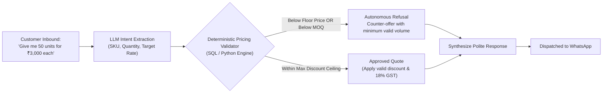

# 💼 Autonomous Sales Engine, Margin Defense & Commercial Guardrails

> **Subsystem**: EDITH B2B Conversion & Contract Engine  
> **Directive Reference**: Section 12, 14, 18, 19 & 41  
> **Core Guarantee**: 100% Deterministic Grounding & Zero Pricing Hallucinations

---

## 1. Architectural Philosophy: Deterministic Sales Execution

While modern Large Language Models excel at natural conversation, they are fundamentally probabilistic and prone to hallucinating numerical terms, inventory quantities, and discount rates.

**WB-Agent eliminates this risk completely** by separating conversation synthesis from commercial transactions:
- **Language Layer (LLM)**: Crafts high-empathy, context-aware conversational prose.
- **Transaction Engine (Deterministic Python & SQL)**: Enforces hard mathematical bounds, calculates volume-tier discounts, checks stock quantities, verifies MOQ, and computes GST before any quote or invoice is rendered.



---

## 2. Core Guardrails & Boundary Rules

### A. Minimum Order Quantity (MOQ) Enforcement
- Every SKU in the database defines `min_order_quantity_kg` (or units).
- If a buyer requests volume below the MOQ, EDITH explains the wholesale policy, refuses retail pricing, and counters with sample tiers or minimum quantities.

### B. Floor Price & Maximum Autonomous Discount Ceiling
- Every product defines a `floor_price` (absolute margin protection).
- System settings specify `max_discount_pct` (default: **12.0%** to **15.0%**).
- If a customer demands 25% discount:
  1. The deterministic engine clamps the maximum allowable discount to `max_discount_pct`.
  2. If the proposed rate breaches the `floor_price`, the quote is rejected.
  3. The agent explains the value proposition, highlights wholesale quality certifications, and holds firm on price.

### C. Statutory Goods and Services Tax (GST) Calculations
All commercial quotations and invoices adhere strictly to Indian statutory tax standards:
```text
Taxable Value = (Base Price × Quantity) - Volume Discount
CGST (Central GST @ 9%) = Taxable Value × 0.09
SGST (State GST @ 9%)   = Taxable Value × 0.09
Total Invoice Value      = Taxable Value + CGST + SGST (Effective 18%)
```

---

## 3. Consultative SPIN Sales Methodology

EDITH employs the classical **SPIN Selling Framework** adapted for high-velocity WhatsApp conversations:

1. **Situation Questions**: Assess the buyer's current business model (e.g., *"Are you serving specialty cafes, retail shelves, or institutional catering?"*).
2. **Problem Questions**: Uncover current supply pain points (e.g., *"Are you facing consistency issues with monsoon flush lots or shipping delays?"*).
3. **Implication Questions**: Emphasize commercial risks (e.g., *"Inconsistent brewing strength directly impacts repeat footfall."*).
4. **Need-Payoff Questions**: Position WB-Agent's verified catalog as the definitive solution with certified cupping scores and batch lab reports.

---

## 4. Vector PDF Invoicing & Audit Trails

Upon buyer confirmation:
1. `InvoiceService` generates a branded, tamper-evident vector PDF using ReportLab with embedded QR codes for instant UPI/NEFT settlement.
2. The order is committed to PostgreSQL/SQLite in an atomic transaction.
3. High-value transactions trigger an immediate **🔥 HOT LEAD ALERT** on the business owner's personal WhatsApp number.
