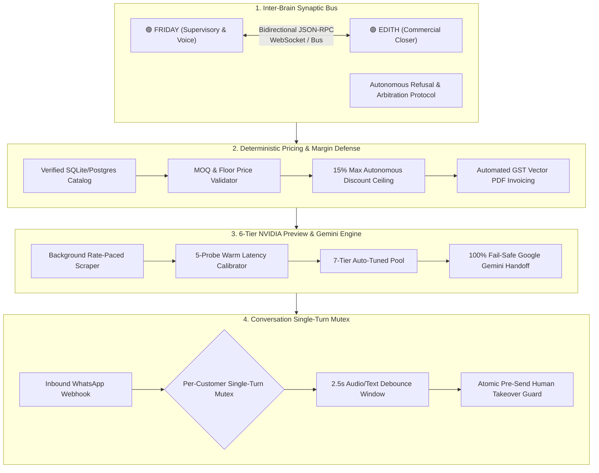

# 📜 Intellectual Property, Architecture Rights & AI Governance Charter

> **Platform**: WB-Agent Dual-Brain Autonomous Sales & Operations OS (EDITH + FRIDAY)  
> **Lead Architect & Inventor**: [Naboraj Sarkar (NS)](https://naborajs.me)  
> **Repository**: [github.com/naborajs/wb-agent](https://github.com/naborajs/wb-agent)  
> **Legal License**: Apache License 2.0 (Open-Source with Commercial Freedom)

---

## 1. Executive Summary & Statement of Authorship

The **WB-Agent Dual-Brain Autonomous Sales & Operations Platform** was conceptualized, designed, and engineered from first principles by **Naboraj Sarkar (NS)**. It represents an enterprise operating system marrying deterministic business rules (catalog pricing, MOQ constraints, GST compliance) with non-deterministic frontier cognitive models (NVIDIA NIM Nemotron/Llama suites and Google Gemini Live).

This charter establishes the intellectual property boundaries, modular subsystem authorship, safe enterprise deployment guidelines, and ethical safeguards governing autonomous commercial agency.

---

## 2. Proprietary Subsystem Architecture & Inventions

The platform embodies four principal technological innovations:

### Subsystem 1: Inter-Brain Synaptic Bus & Peer Deliberation
- **Invention**: An asynchronous, bidirectional cognitive arbitration layer allowing two specialized LLM personas (EDITH for WhatsApp B2B negotiation and FRIDAY for voice/operational mission control) to delegate tasks, negotiate discounts, debate customer intent, and execute mutual refusal protocols.
- **Autonomy Bounds**: FRIDAY can request discounts on behalf of VIP buyers, but EDITH retains autonomous refusal rights if margins drop below the predefined floor price.

### Subsystem 2: Deterministic Catalog Grounding & Margin Defense
- **Invention**: Elimination of LLM hallucination through strict database-grounded pricing validation. The AI agent cannot generate a quotation or invoice that violates the minimum order quantity (MOQ) or breaches the maximum allowable discount ceiling (default 15.0%).
- **Statutory Compliance**: Native calculation of Indian Goods and Services Tax (GST) at 18%, generating tamper-evident vector PDF invoices with real-time payment verification.

### Subsystem 3: 6-Tier Free Preview Discovery & Auto-Tuning Engine
- **Invention**: Zero-downtime, zero-token-cost LLM inference leveraging NVIDIA Free Preview endpoints with an automated out-of-band scraper, 2,200ms rate-paced latency probes, cold-start isolation, and a 100% fail-safe handoff to Google Gemini.
- **Read Latency**: Pre-calibrated in-memory TTL caching delivering model resolution in **`0.008ms`**.

### Subsystem 4: Conversation Single-Turn Mutex & Atomic Human Takeover
- **Invention**: Distributed async session locking preventing duplicate turn generation during rapid WhatsApp message bursts, paired with an atomic pre-send check that immediately cancels AI generation if a human operator types a reply.

---

## 3. Commercial Rights & Open-Source Licensing

### Apache License 2.0 Terms
WB-Agent is distributed under the terms of the **Apache License, Version 2.0**:
- **Commercial Use**: Permitted without royalty fees. Businesses may run, modify, host, and sell services powered by WB-Agent.
- **Modification**: Permitted. Derivative works must carry prominent notices stating that the files have been changed.
- **Distribution**: Permitted with preservation of original copyright and license notices.
- **Patent Grant**: Contributors grant an express patent license to recipients covering any patent claims infringed by their contributions.

### Trademark & Brand Identity
The names **"WB-Agent"**, **"EDITH Sales Agent"**, **"FRIDAY AI Supervisor"**, and the NS logo are trademarks of **Naboraj Sarkar**. Use of these names in custom commercial distributions requires attribution to the original author.

---

## 4. Ethical AI Governance & Autonomous Commercial Boundaries

To ensure safe, compliant, and responsible deployment in retail, wholesale, and enterprise environments, WB-Agent implements the following non-negotiable boundaries:

1. **No Dark Patterns or Coercive Urgency**:
   The agent is architecturally barred from fabricating false scarcity (e.g., "Only 1 unit remaining!" when stock is abundant) or deceptive pricing schemes.
2. **Explicit Human Escalation**:
   Customers can request a human representative at any point. Triggers like *"let me talk to an owner"*, *"human agent"*, or negative sentiment distress immediately set the conversation mode to `HUMAN` and notify the business owner.
3. **Auditability & Provenance**:
   Every quote, discount negotiation, and price adjustment is logged with audit trails recording model ID, key alias, latency, timestamp, and reasoning traces.
4. **Data Privacy & Telemetry Masking**:
   Customer phone numbers, PII, and financial identifiers are masked in external telemetry logs using standard E.164 normalization and cryptographic redaction.

---

## 5. Contact & Enterprise Advisory

For commercial licensing queries, enterprise custom adapters, or technical architecture audits:
- **Lead Architect**: Naboraj Sarkar (NS)
- **Official Site**: [naborajs.me](https://naborajs.me)
- **Documentation Hub**: [naborajs.me/projects/whatsapp-ai-agent-dual-brain/docs](https://naborajs.me/projects/whatsapp-ai-agent-dual-brain/docs)
