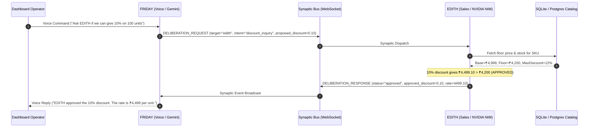

# 🧠 NVIDIA & Gemini Dual-Brain Technical Protocol Specification

> **Specification Version**: 2.5.0  
> **Target Subsystems**: NVIDIA NIM Inference Layer (`integrate.api.nvidia.com`), Google Gemini Live Audio Engine (`v1beta`), Inter-Brain Synaptic Bus (`/api/v1/ws/brain`)

---

## 1. System Topology & Dual-Brain Division of Labor

The WB-Agent platform coordinates two asymmetric cognitive brains designed for complementary commercial capabilities:

| Cognitive Role | Brain Designation | Primary Provider | Underlying Model | Primary Interface | Latency SLA |
| :--- | :--- | :--- | :--- | :--- | :--- |
| **B2B Closer & Negotiator** | **🟢 EDITH** | NVIDIA NIM | `nvidia/nemotron-3.5-super-vl-120b-a12b` (Fallback: `meta/llama-3.2-11b-vision-instruct`) | Asynchronous WhatsApp Webhook & REST | `< 800ms` (Warm) |
| **Voice & Mission Control** | **🟣 FRIDAY** | Google Gemini | `gemini-3.1-flash-live-preview` (Fallback: `gemini-2.5-flash-lite`) | WebSockets (16kHz PCM Full-Duplex Audio) | `< 180ms` (Real-Time) |

---

## 2. Inter-Brain Synaptic Bus Protocol

The two brains communicate over an internal event-driven message bus (`app/brain/inter_brain_bus.py`) adhering to the Synaptic RPC Specification:



### Event Types on the Synaptic Bus:
1. `synaptic_ping`: Heartbeat and latency telemetry check.
2. `deliberation_request`: Cognitive consultation initiated by either brain.
3. `deliberation_response`: Resolution with structured metadata, pricing, or refusal reason.
4. `autonomous_refusal`: Hard guardrail rejection when commercial bounds (MOQ / floor price) are violated.
5. `emotional_debrief`: Post-negotiation analysis summarizing buyer objections and closing probabilities.

---

## 3. NVIDIA 6-Tier Fallback Calibration & Pacing Strategy

NVIDIA's preview tier provides cutting-edge open weights under a strict 30–40 RPM rate limit per key. The auto-tuning engine ([`scripts/tune-nvidia-models.mjs`](../scripts/tune-nvidia-models.mjs)) benchmarks upstream endpoints out-of-band:

```text
Rate-Limit Pacing Formula:
  Delay between requests = 2,200ms
  Throughput = 60s / 2.2s = 27.27 RPM (Safe buffer below 30 RPM threshold)
```

### Cold Start vs Warm Latency Isolation:
For every model candidate discovered on `build.nvidia.com`:
- **Request 1**: Handshake + cold start penalty (recorded as `coldStartLatencyMs`).
- **Requests 2 through 5**: Sequential warm execution (averaged as `warmLatencyMs`).
- **Ranking**: Ascending order of `warmLatencyMs`, with cold start strictly excluded from the sort key.

---

## 4. Google Gemini Live Full-Duplex Audio Integration

FRIDAY integrates with Google Gemini Live Preview using raw 16kHz linear PCM streaming:
- **Audio Uplink**: Browser `AudioWorkletNode` captures microphone stream, downsamples to 16,000Hz mono linear PCM, and streams 100ms audio chunks over WebSocket.
- **Audio Downlink**: Gemini returns 24kHz raw PCM frames played via scheduled `AudioBufferSourceNode` buffers for seamless, interruption-tolerant playback.
- **Token Security**: Ephemeral session tokens are minted by the backend (`/api/v1/voice/session-token`), strictly isolating master API keys from the client bundle.

---

## 5. Failure Mode Recovery Matrix

| Failure Condition | Detection Mechanism | Immediate Action | Secondary Recovery |
| :--- | :--- | :--- | :--- |
| **Model Deprecated (`HTTP 404` / `410`)** | Client HTTP status code inspection | Advance to Fallback 1 on active key | Trigger background pool re-benchmark |
| **NVIDIA Server Overloaded (`HTTP 503`)** | Client HTTP status code inspection | Advance to Fallback 2 on active key | Exponential backoff cooldown |
| **Key Exhaustion (`HTTP 401` / `403`)** | Client HTTP status code inspection | Switch to Secondary API Key (`NVIDIA_FALLBACK_API_KEY`) | Queue operator alert on WhatsApp |
| **Total NVIDIA Outage (All 7 Tiers Fail)** | All 7 models exhausted across all keys | **100% Fail-Safe Handoff to Google Gemini** (`gemini-2.5-flash-lite`) | Zero dropped customer messages |
